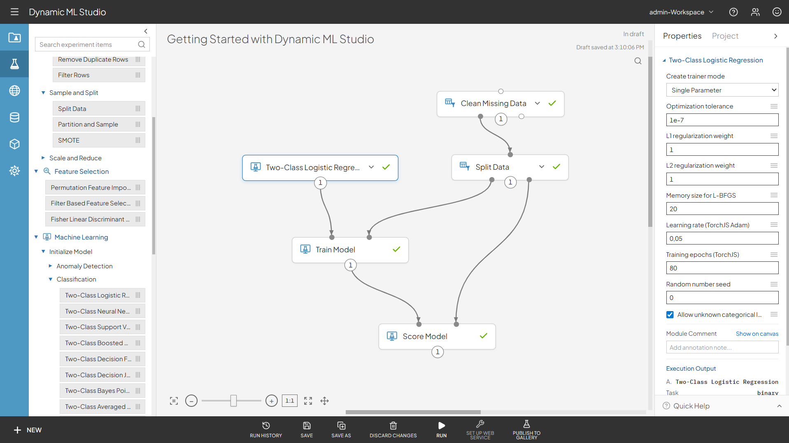
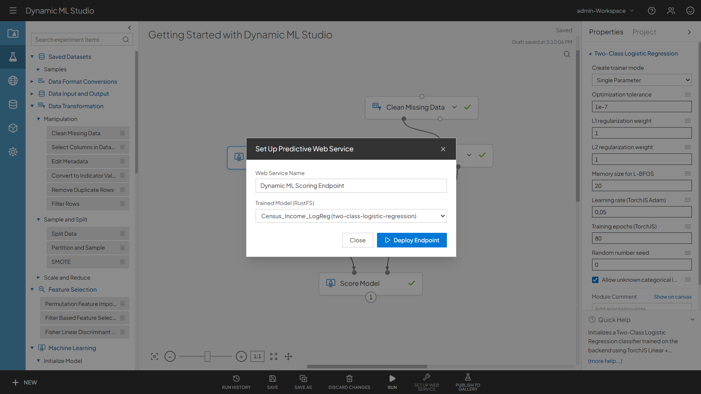
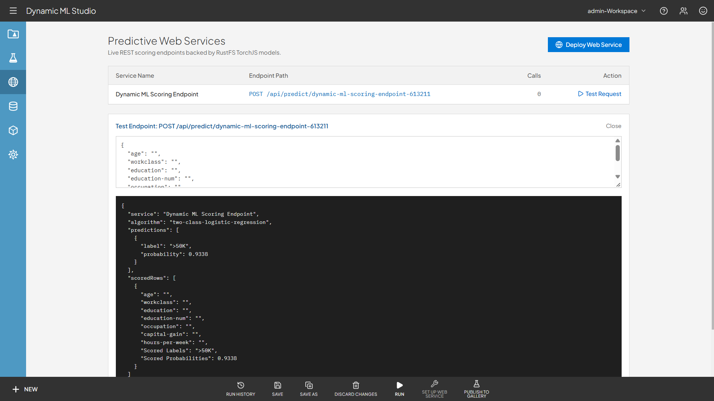
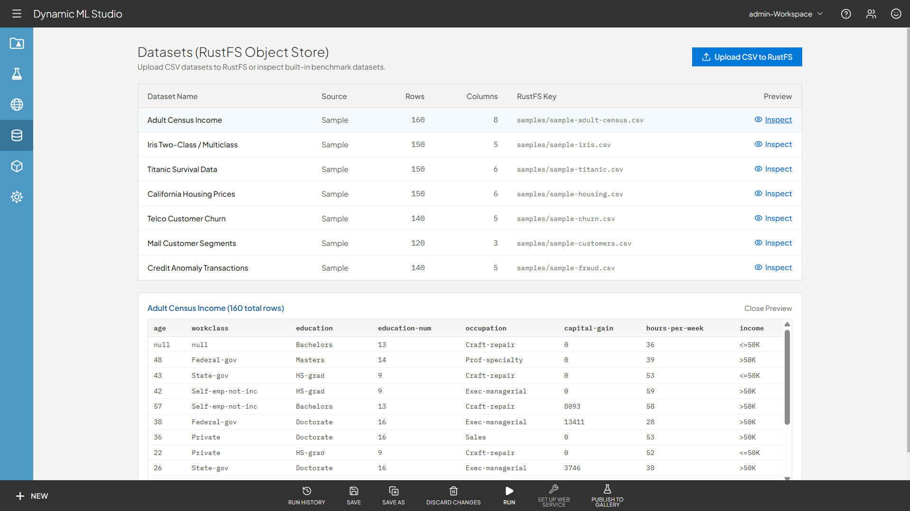
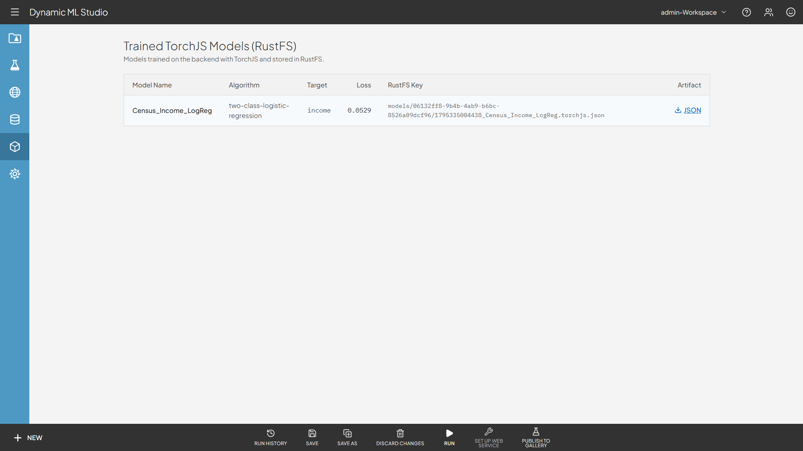
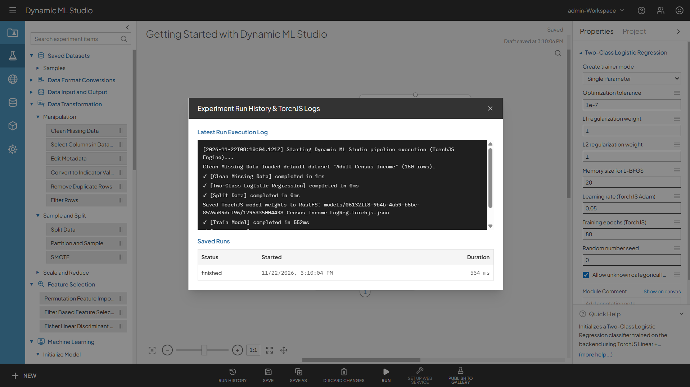

<div align="center">

# Dynamic ML Studio

**Visual node-based drag-and-drop machine learning pipeline studio powered by TorchJS, Drizzle ORM, PostgreSQL, and RustFS.**

[](https://react.dev/)
[](https://www.typescriptlang.org/)
[](https://tailwindcss.com/)
[](https://expressjs.com/)
[](https://orm.drizzle.team/)
[](https://github.com/eduardoleao052/js-torch)
[](https://rustfs.com/)

</div>

---

## Interface & Workflow Showcase

<p align="center">
  
</p>

<table>
  <tr>
    <td width="33.33%" align="center" valign="top">
      
      <br />
      <sub><b>Set Up Predictive Web Service</b> — Deploy trained RustFS models as live REST endpoints</sub>
    </td>
    <td width="33.33%" align="center" valign="top">
      
      <br />
      <sub><b>Live Inference Testing</b> — Real-time JSON scoring via <code>POST /api/predict/:slug</code></sub>
    </td>
    <td width="33.33%" align="center" valign="top">
      
      <br />
      <sub><b>Datasets (RustFS)</b> — Upload CSV files and inspect tabular previews</sub>
    </td>
  </tr>
  <tr>
    <td width="33.33%" align="center" valign="top">
      
      <br />
      <sub><b>Trained TorchJS Models</b> — Persist & download <code>.torchjs.json</code> weight artifacts</sub>
    </td>
    <td width="33.33%" align="center" valign="top">
      
      <br />
      <sub><b>Run History &amp; Logs</b> — Inspect topological execution steps and durations</sub>
    </td>
    <td width="33.33%" align="center" valign="middle">
      <sub><b>Key Capabilities</b><br /><br />Drag-and-drop DAG canvas<br />TorchJS autograd training<br />PostgreSQL + Drizzle persistence<br />RustFS S3 dataset &amp; model store<br />1-click REST inference endpoints</sub>
    </td>
  </tr>
</table>

---

## Project Structure

```text
dynamic-ml-studio/
├── docs/                           # Documentation screenshots & visual assets
│   ├── screen_dml_main.png
│   ├── screen_dml_2.png
│   ├── screen_dml_3.png
│   ├── screen_dml_4.png
│   ├── screen_dml_5.png
│   └── screen_dml_6.png
├── src/
│   ├── components/
│   │   ├── InspectorPanel.tsx      # Dynamic node properties, sweep controls & Quick Help
│   │   ├── PaletteSidebar.tsx      # Searchable hierarchical ML module toolbox
│   │   ├── PipelineCanvas.tsx      # Drag-and-drop DAG canvas, Bezier wires, zoom & notes
│   │   ├── StudioIcons.tsx         # Studio SVG icon set for rail & module categories
│   │   ├── StudioModals.tsx        # Auth, RustFS CSV upload, TorchJS metrics & deploy modals
│   │   └── WorkspaceViews.tsx      # Projects, Web Services, Datasets, Models & Settings views
│   ├── db/
│   │   ├── index.ts                # PostgreSQL pool & Drizzle ORM bootstrapper
│   │   └── schema.ts               # Drizzle tables (users, experiments, datasets, models, runs, services)
│   ├── lib/
│   │   └── api.ts                  # Typed REST API client with Bearer token session memory
│   ├── server/
│   │   ├── auth.ts                 # scrypt password hashing & HMAC-SHA256 Bearer auth
│   │   ├── ml-engine.ts            # Topological DAG runner + TorchJS training/scoring/eval
│   │   ├── rustfs.ts               # S3-compatible RustFS client with local bucket fallback
│   │   └── store.ts                # Drizzle PostgreSQL repository with runtime fallback
│   ├── shared/
│   │   ├── catalog.ts              # Full ML module catalog, ports, hyperparams & default graph
│   │   ├── sampleDatasets.ts       # Built-in benchmark datasets & schema inference
│   │   └── types.ts                # Shared TypeScript interfaces for graph, nodes & execution
│   ├── App.tsx                     # Root Studio shell, responsive drawers & state orchestration
│   ├── index.css                   # Tailwind v4 configuration, typography & studio scrollbars
│   └── main.tsx                    # React DOM entry point
├── .env.example                    # Discrete PG* & RustFS environment variable template
├── drizzle.config.ts               # Drizzle Kit configuration using split PG parameters
├── index.html                      # HTML entry & metadata
├── metadata.json                   # Application manifest
├── package.json                    # Dependencies and npm scripts
├── server.ts                       # Unified Express + Vite dev/prod server on port 3000
├── tsconfig.json                   # TypeScript configuration
└── vite.config.ts                  # Vite bundler configuration
```

---

## Apps System Architecture

Dynamic ML Studio uses a unified full-stack TypeScript architecture separating visual DAG authoring on the client from deterministic TorchJS execution, relational metadata storage, and S3 object persistence on the backend:

```text
+-----------------------------------------------------------------------------+
|                        Browser Client (React 19 + Vite)                     |
|  - Module Palette (Drag & Drop)      - Interactive DAG Canvas (SVG + DOM)   |
|  - Properties Inspector & Sweep UI   - TorchJS Loss / Matrix Visualizer     |
+--------------------------------------+--------------------------------------+
                                       | HTTPS / REST JSON (Bearer Auth)
                                       v
+-----------------------------------------------------------------------------+
|                     Express Backend Server (server.ts :3000)                |
|                                                                             |
|  +-----------------------+    +------------------------------------------+  |
|  | Auth & Access Layer   |    | TorchJS Pipeline Engine (ml-engine.ts)   |  |
|  | - scrypt + salt       |    | - Topological DAG sort & validation      |  |
|  | - HMAC-SHA256 tokens  |    | - Clean / Split / Normalize / Encode     |  |
|  | - Ownership checks    |    | - js-pytorch autograd (Linear/MLP/Adam)  |  |
|  +-----------------------+    | - Evaluate (Accuracy, AUC, Matrix, R²)    |  |
|                               +--------------------+---------------------+  |
|                                                    |                        |
|            +---------------------------------------+------------------+     |
|            v                                                          v     |
|  +------------------------------+      +---------------------------------+  |
|  | PostgreSQL + Drizzle ORM     |      | RustFS (S3-Compatible Storage)  |  |
|  | - users, experiments         |      | - CSV datasets (datasets/*)     |  |
|  | - datasets, trained_models   |      | - TorchJS weights (*.json)      |  |
|  | - experiment_runs, services  |      | - Exported artifacts (exports/*)|  |
|  +------------------------------+      +---------------------------------+  |
+-----------------------------------------------------------------------------+
```

### Key Architectural Flows

1. **Visual Pipeline Authoring**: Users compose directed acyclic graphs (DAGs) by dragging modules from the left taxonomy tree onto the canvas, wiring typed output ports to input ports via cubic Bezier curves, configuring hyperparameters or parameter-sweep ranges, and adding collapsible inline node annotations.
2. **Backend TorchJS Execution**: Clicking **RUN** sends `graphJson` to `POST /api/pipelines/run`. The backend performs a topological sort, resolves input datasets from RustFS or built-in samples, runs preprocessing nodes, trains classification/regression/clustering/anomaly models using `js-pytorch`, scores test splits, and returns per-node previews, training loss curves, confusion matrices, and feature weights.
3. **Persistence & Model Serving**:
   - **PostgreSQL (Drizzle ORM)** stores user accounts, saved experiment graphs, dataset metadata, trained model records, run history logs, and deployed web service slugs.
   - **RustFS** stores raw uploaded CSV files and serialized TorchJS model weight artifacts (`.torchjs.json`).
   - **Web Services** expose live scoring endpoints (`POST /api/predict/:slug`) that load serialized models from RustFS and score incoming JSON payloads on demand.

---

## Tech Stack

| Layer | Technology | Purpose |
| :--- | :--- | :--- |
| **Frontend UI** | React 19, TypeScript, Tailwind CSS v4, Lucide Icons | Responsive 3-pane visual ML IDE, drag-and-drop canvas, SVG Bezier port wiring |
| **Backend API** | Node.js, Express 4, `tsx` | Unified API server and Vite middleware / static asset host |
| **Authentication** | Node `crypto` (`scrypt`, `timingSafeEqual`, HMAC-SHA256) | Salted password hashing and stateless Bearer session tokens |
| **ML Engine** | `js-pytorch` (TorchJS), PapaParse | Tensor autograd training (`Linear`, `ReLU`, `CrossEntropyLoss`, `MSELoss`, `Adam`), tree ensembles, K-Means, CSV parsing |
| **Database & ORM** | PostgreSQL (Supabase Pooler), Drizzle ORM, `pg` | Relational persistence with parameterized queries and automatic schema bootstrap |
| **Object Storage** | RustFS (`@aws-sdk/client-s3`) | S3-compatible bucket storage for CSV datasets and trained model artifacts |

---

## How to Build

### 1. Prerequisites

- **Node.js** `>= 20.x` (or **Bun**)
- **PostgreSQL** database (e.g., Supabase Postgres)
- **RustFS** S3-compatible endpoint (optional; falls back to isolated local bucket storage if omitted)

### 2. Configure Environment Variables

Copy `.env.example` to `.env` (or configure secrets in your hosting environment) using the discrete PostgreSQL parameters:

```env
# PostgreSQL discrete parameters
PGHOST=aws-1-ap-northeast-1.pooler.supabase.com
PGPORT=5432
PGDATABASE=postgres
PGUSER=postgres.your_project_ref
PGPASSWORD=your_database_password
PGSSLMODE=require

# RustFS S3-compatible object storage
RUSTFS_ENDPOINT=http://localhost:9000
RUSTFS_REGION=us-east-1
RUSTFS_ACCESS_KEY=your_rustfs_access_key
RUSTFS_SECRET_KEY=your_rustfs_secret_key
RUSTFS_BUCKET=dynamic-ml-studio

# Session signing secret (auto-generated in-memory if omitted)
SESSION_SECRET=replace_with_random_64_char_secret
```

### 3. Install Dependencies & Push Schema

```bash
npm install
npm run db:push
```

### 4. Development & Verification

```bash
# Start full-stack Express + Vite dev server on port 3000
npm run dev

# Run TypeScript type checks
npm run lint

# Build production frontend bundle into dist/
npm run build
```

---

## How to Deploy

1. **Build the client bundle**:
   ```bash
   npm run build
   ```
   This compiles the React SPA into `dist/`.

2. **Set production environment variables** in your target runtime (Cloud Run, VPS, Docker, or Railway):
   - `NODE_ENV=production`
   - `PORT=3000`
   - `PGHOST`, `PGPORT`, `PGDATABASE`, `PGUSER`, `PGPASSWORD`, `PGSSLMODE=require`
   - `RUSTFS_ENDPOINT`, `RUSTFS_REGION`, `RUSTFS_ACCESS_KEY`, `RUSTFS_SECRET_KEY`, `RUSTFS_BUCKET`
   - `SESSION_SECRET`

3. **Start the production server**:
   ```bash
   npm start
   ```
   `server.ts` serves both the REST API (`/api/*`) and the compiled static frontend (`dist/`) on `0.0.0.0:3000`, and idempotently initializes PostgreSQL tables via `initDatabase()` on startup.
